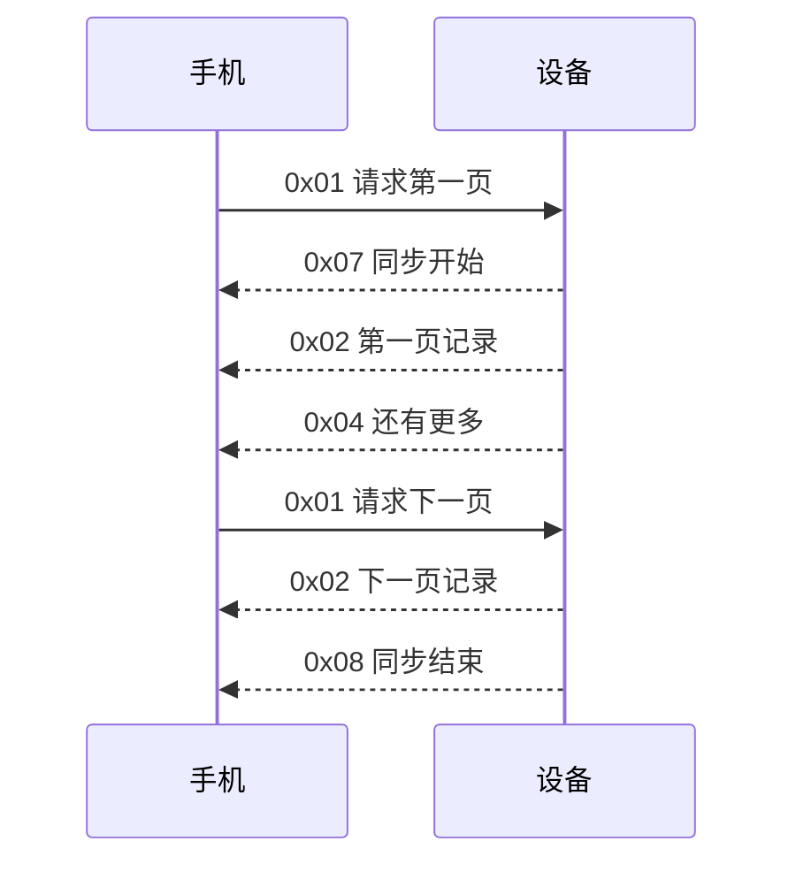
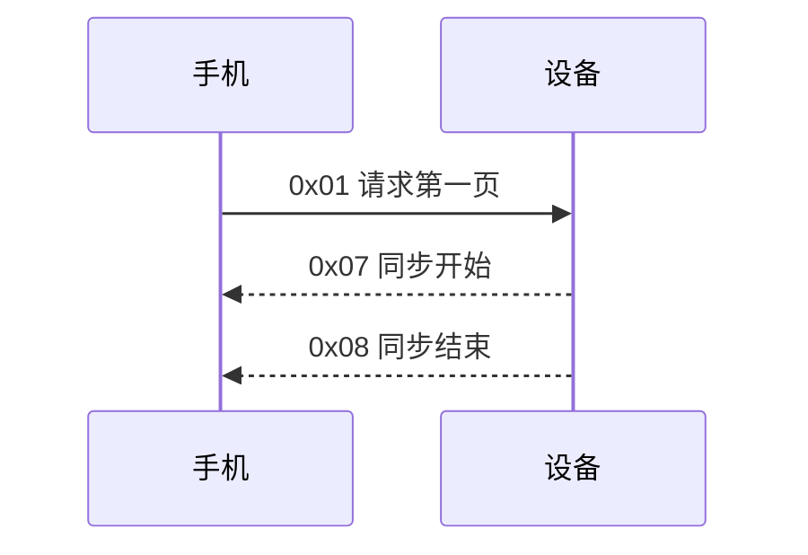

# 3.6 运动数据命令 (command id 0x05)

L2 版本号：**1**

!!! warning "实现现状"

    **运动数据（Data type `0x01`）双端已实现，可联调；睡眠数据（Data type `0x02`）仍未实现。**

    - 设备端 `hmi_l2_cmd_sport.c` 已实现完整的运动历史同步会话：解析 `0x01` 的 Data type、经 `app_health_read_history()` 分页读取 pedo TSDB、按序发送 `0x07` → `0x02` → `0x04`/`0x08`，并在 `EVT_BLE_DISCONNECTED` 时作废会话。
    - 手机端 `HoneyBox` 的 `watch_health_protocol.dart` / `watch_health_repository.dart` 已迁移到 version 1：请求携带 Data type、按 `0x10` 校验 L2 Header、解析 18 字节记录、marker 按 Data type 归属会话。
    - 睡眠数据（Key `0x03`）设备端连存储层都还没有：既无 sleep TSDB，也无 `sleep_state_record_t` 结构与读取 API。设备收到 Data type `0x02` 的请求时**不创建会话、不回任何响应**（符合本节「其他值保留，设备收到后不得创建同步会话」的处理方式），手机端同步会超时。本节睡眠部分的线格式属于已定稿设计，手机端解码已按规范实现，设备端补齐存储与算法接入后即可联调。
    - 逐次心率（Key `0x0d`）在 version 1 中为保留编号，双端均不发送。心率只以「桶内平均值」形式出现在 `0x02` 的 `Sport bucket record` 中，由 `Flags.HAS_HR` 指示有效性。

版本 1 以设备持久化记录为数据源。运动记录和睡眠记录分别存放在独立的 FlashDB TSDB 中，线上记录与对应 FlashDB 记录字段一一对应。多字节整数按本协议统一使用大端序编码，禁止直接复制 MCU 内存中的结构体字节。

版本 1 定义运动/平均心率和睡眠数据的独立分页同步。未在下表标记为 “已定义”的 Key 均为保留编号，手机和设备不得发送，也不得依赖旧版草案中的 Value 格式。

| Key    | 方向      | 状态   | 定义                                          |
|--------|-----------|--------|-----------------------------------------------|
| `0x01` | 手机→设备 | 已定义 | 按 Data type 请求当前同步会话的下一页历史数据 |
| `0x02` | 设备→手机 | 已定义 | 返回一页 15 分钟运动统计记录（含平均心率）    |
| `0x03` | 设备→手机 | 已定义 | 返回一页睡眠状态变化记录                      |
| `0x04` | 设备→手机 | 已定义 | More flag，还有下一页                         |
| `0x05` | —         | 保留   | 睡眠设置数据                                  |
| `0x06` | —         | 保留   | 实时同步设置                                  |
| `0x07` | 设备→手机 | 已定义 | 历史同步开始                                  |
| `0x08` | 设备→手机 | 已定义 | 历史同步结束                                  |
| `0x09` | —         | 保留   | 当天运动汇总                                  |
| `0x0a` | —         | 保留   | 最近一条运动记录                              |
| `0x0b` | —         | 保留   | 当天运动数据校准                              |
| `0x0c` | —         | 保留   | 当天运动数据校准返回                          |
| `0x0d` | —         | 保留   | 独立心率数据                                  |

## 版本与通用约束

- SPORT version 1 的 L2 Header 固定为 `05 10`：Command ID=`0x05`， Version=`1`，Reserve=`0`。
- 每个 Key 都放在独立的 L2 数据包中；本命令不在同一个 L2 包内合并多个 Key。
- L2 Header 的 Reserve 必须为 `0`；Health record 的 Flags 未定义位必须为 `0`。Health record 的 `Reserved` 字段按记录原值传输，接收方当前只保存、不解释。
- 手机必须等待 `0x04` More flag 后再请求下一页；不得并发发送多个 `0x01`。
- 一次 BLE 连接中同一时刻最多存在一个历史同步会话。运动和睡眠必须分别发起同步，不得在同一会话中切换 Data type。
- BLE 断开后当前同步会话作废；重新连接后从第一条历史记录重新开始。
- Version 0 的 SPORT 数据格式已废弃，不属于本规范的联调范围。

## 0x01 — 请求数据

**方向**：手机→设备  
**Value**：Data type（1 byte），v-length 必须为 `1`

| Data type | 数据集                         | 返回 Key |
|-----------|--------------------------------|----------|
| `0x01`    | 15 分钟运动统计 + 桶内平均心率 | `0x02`   |
| `0x02`    | 睡眠状态变化记录               | `0x03`   |

其他值保留，设备收到后不得创建同步会话。

请求运动数据的完整 L2 字节流：

| 字节 | 值 | 含义 |
|------|----|------|
| 0 | `05` | Command ID = `0x05` |
| 1 | `10` | Version = 1，Reserve = 0 |
| 2 | `01` | Key = `0x01` |
| 3~4 | `00 01` | v-length = 1 |
| 5 | `01` | Data type = `0x01`（运动） |

请求睡眠数据：`05 10 01 00 01 02`。

第一次请求创建对应 Data type 的同步会话，并从该 TSDB 最早的可用记录开始读取。收到 `0x04` 后，下一次请求必须携带相同的 Data type，继续读取下一页。同步结束后，手机可再发起另一个 Data type 的同步。

## 0x02 — 15 分钟运动统计返回（含平均心率）

**方向**：设备→手机  
**Value**：Record count（1 byte）+ N × Sport bucket record（18 bytes）

运动数据以 15 分钟为一个统计单位。每条 `Sport bucket record` 对应 FlashDB 中的一条 15 分钟运动桶记录，同时携带该桶内的步数、距离、卡路里和平均心率。平均心率是否有效由 `Flags.HAS_HR` 指示；它不是独立的实时心率采样。

每个桶的配置宽度固定为 15 分钟，并与墙上时钟的 `00/15/30/45` 分钟边界对齐。统计区间为左闭右开区间 `[Timestamp, Timestamp + 15 分钟)`，其中 `Timestamp` 是逻辑桶的起始时间，与 FlashDB 记录时间完全一致。正常桶和 partial bucket 的 `Timestamp` 都必须落在自然刻钟边界。

Timestamp 即设备显示的墙上时钟时刻（wall clock seconds，1970 纪元），手机直接渲染即可，无需任何时区转换。

| 字段                 | 宽度         | 约束                          |
|----------------------|--------------|-------------------------------|
| Record count         | 1 byte       | `1~8`，必须与后续记录数量一致 |
| Sport bucket records | N × 18 bytes | 按 Timestamp 从旧到新排列     |

Value 长度必须满足：`v-length = 1 + Record count × 18`。设备每页最多返回 8 条记录。满页 Value 为 `145 bytes`，完整 L2 包为 `150 bytes`，加上 8-byte L1 Header 后完整 L1 帧为 `158 bytes`；L0 根据实际 ATT payload 大小继续分片。

**Sport bucket record（18 bytes）**：

| 偏移 | 字段           | 宽度    | 字节序 | 说明                                                                                          |
|------|----------------|---------|--------|-----------------------------------------------------------------------------------------------|
| 0    | Timestamp      | 4 bytes | 大端   | 自然刻钟逻辑桶的起始墙上时钟秒（自 1970-01-01 起算，与设备显示一致），与 FlashDB 记录时间一致 |
| 4    | Steps          | 2 bytes | 大端   | 该运动桶内累计步数                                                                            |
| 6    | Distance       | 2 bytes | 大端   | 该运动桶内累计距离，单位 m                                                                    |
| 8    | Calories       | 2 bytes | 大端   | 该运动桶内累计卡路里，单位 0.1 kcal                                                           |
| 10   | Heart rate     | 1 byte  | —      | 该运动桶的平均心率，单位 bpm；仅当 `Flags.HAS_HR=1` 时有效，否则必须为 `0`                    |
| 11   | Bucket minutes | 1 byte  | —      | 运动统计桶配置宽度，version 1 固定为 `15`                                                     |
| 12   | Mode           | 1 byte  | —      | `0`=步行，`1`=跑步，`2`=无效                                                                  |
| 13   | Flags          | 1 byte  | —      | bit0=`HAS_HR`，bit1=`PARTIAL_BUCKET`，其余保留                                                |
| 14   | Reserved       | 4 bytes | 大端   | 保留字段，当前发送 FlashDB 中保存的原值                                                       |

**Partial bucket**：设备因关机、解绑、低电或调试强制刷新而提前落库时，必须设置 `Flags.PARTIAL_BUCKET=1`。`Bucket minutes` 仍固定为 `15`，表示该记录属于 15 分钟统计模型；它不表示 partial bucket 的实际采集时长。正常完整桶必须设置 `Flags.PARTIAL_BUCKET=0`。

`Timestamp` 始终是所属自然刻钟逻辑桶的起始时间。例如设备仅在 `10:07~10:12` 采集并提前落库，该记录仍属于 `[10:00, 10:15)`， `Timestamp=10:00` 且 `PARTIAL_BUCKET=1`。手机只能将其标记为 “不完整的 15 分钟桶”；当前协议不表达实际采集起止时间，不得根据 `Bucket minutes` 反推。设备保证同一自然刻钟最多产生一条运动记录。

手机必须直接按 `Timestamp` 进行日期和时段聚合，不得减一秒或减 15 分钟。例如在 `2026-08-27 00:00:00` 闭合的最后一个桶使用 `Timestamp=2026-08-26 23:45:00`，因此归属 `2026-08-26`。

单条记录示例：

| 字段 | 值 |
|------|----|
| Timestamp | `0x12345678` |
| Steps | `0x1122` |
| Distance | `0x3344` |
| Calories | `0x5566` |
| Heart rate | `0x77` |
| Bucket minutes | `0x0F` |
| Mode | `0x01` |
| Flags | `0x01` |
| Reserved | `0x00000000` |

对应的完整 L2 字节流：

`05 10 02 00 13 01 12 34 56 78 11 22 33 44 55 66 77 0F 01 01 00 00 00 00`

| 字节 | 值 | 含义 |
|------|----|------|
| 0 | `05` | Command ID = `0x05` |
| 1 | `10` | Version = 1 |
| 2 | `02` | Key = `0x02` |
| 3~4 | `00 13` | v-length = 19 |
| 5 | `01` | Record count = 1 |
| 6~23 | `12 34 56 78 … 00 00 00 00` | Sport bucket record（18 bytes，字段见上表） |

## 0x03 — 睡眠状态变化记录返回

**方向**：设备→手机  
**Value**：Record count（1 byte）+ N × Sleep record（8 bytes）

睡眠使用独立的 FlashDB Sleep TSDB。睡眠算法每次确认状态变化时，以该状态实际生效的墙上时钟秒写入一条 `sleep_state_record_t`。算法产生的回溯分钟数必须在写入 FlashDB 前折算到 Timestamp，协议层不再转换时间。

| 字段          | 宽度        | 约束                           |
|---------------|-------------|--------------------------------|
| Record count  | 1 byte      | `1~18`，必须与后续记录数量一致 |
| Sleep records | N × 8 bytes | 按 Timestamp 从旧到新排列      |

Value 长度必须满足：`v-length = 1 + Record count × 8`。设备每页最多返回 18 条记录。满页 Value 为 `145 bytes`，完整 L2 包为 `150 bytes`，完整 L1 帧为 `158 bytes`。

**Sleep record（8 bytes）**：

| 偏移 | 字段      | 宽度    | 字节序 | 说明                                                                    |
|------|-----------|---------|--------|-------------------------------------------------------------------------|
| 0    | Timestamp | 4 bytes | 大端   | 状态实际生效的墙上时钟秒（自 1970-01-01 起算），与 FlashDB 记录时间一致 |
| 4    | State     | 1 byte  | —      | 睡眠状态，见下表                                                        |
| 5    | Flags     | 1 byte  | —      | bit0=`BACKFILLED`，其余位保留且必须为 `0`                               |
| 6    | Reserved  | 2 bytes | 大端   | 保留，发送记录中保存的原值；接收方当前只保存、不解释                    |

**State**：

| 值     | 状态  | 说明         |
|--------|-------|--------------|
| `0x00` | OFF   | 设备未佩戴   |
| `0x01` | DEEP  | 深睡         |
| `0x02` | LIGHT | 浅睡         |
| `0x03` | WAKE  | 清醒         |
| `0x04` | REM   | 快速眼动睡眠 |

`BACKFILLED=1` 表示算法在确认状态后，将状态生效时间回溯到了回调时刻之前。无论该标志是否置位，Timestamp 都已经是最终生效时间，手机不得再次减去确认延迟。

每条记录表示“从 Timestamp 开始进入 State”。该状态持续到下一条 Sleep record 的 Timestamp；最后一条记录持续到后续同步收到的新状态记录。记录可跨越午夜，手机不得按自然日拆分或修正 Timestamp。

单条睡眠记录示例：

| 字段 | 值 |
|------|----|
| Timestamp | `0x12345678` |
| State | `0x01`（DEEP） |
| Flags | `0x01`（BACKFILLED） |
| Reserved | `0x0000` |

对应的完整 L2 字节流：

`05 10 03 00 09 01 12 34 56 78 01 01 00 00`

| 字节 | 值 | 含义 |
|------|----|------|
| 0 | `05` | Command ID = `0x05` |
| 1 | `10` | Version = 1 |
| 2 | `03` | Key = `0x03` |
| 3~4 | `00 09` | v-length = 9 |
| 5 | `01` | Record count = 1 |
| 6~13 | `12 34 56 78 01 01 00 00` | Sleep record（8 bytes，字段见上表） |

## 0x04 — More flag

**方向**：设备→手机  
**Value**：Data type（1 byte），v-length 必须为 `1`

- 运动数据还有更多：`05 10 04 00 01 01`
- 睡眠数据还有更多：`05 10 04 00 01 02`

设备发送本 Key 表示当前页之后仍有记录。手机收到后应发送一个新的 `0x01`，并携带相同的 Data type 请求下一页。没有更多记录时设备不得发送本 Key。

## 0x07 / 0x08 — 历史数据同步开始 / 结束

**方向**：设备→手机  
**Value**：Data type（1 byte），v-length 必须为 `1`

- 运动同步开始：`05 10 07 00 01 01`
- 运动同步结束：`05 10 08 00 01 01`
- 睡眠同步开始：`05 10 07 00 01 02`
- 睡眠同步结束：`05 10 08 00 01 02`

`0x07` 在一次同步会话中只发送一次，且必须先于任何 `0x02`。`0x08` 表示会话正常结束；手机收到后不得继续用旧会话请求下一页。Start、More、 End 的 Data type 必须与该会话请求和数据返回类型一致。睡眠同步时 `0x07` 必须先于任何 `0x03`。

## 历史同步时序

有多页数据：

没有历史数据：

空库时不发送 Record count=`0` 的 `0x02` 数据包。

## 异常与兼容处理

- 收到未知或保留 Key：接收方忽略该 Key，不改变当前同步会话。
- 收到 Value 长度与定义不符的 Key：接收方丢弃该 Key。
- `0x02` 的 Record count 超出 `1~8`，或 v-length 不满足 `1 + count × 18`：手机必须丢弃整页，不得入库。
- Timestamp 相同的记录仍按接收顺序处理；手机不得仅以 Timestamp 去重。
- L1 发送失败、BLE 断开或设备读取存储失败时，本次同步会话终止；手机重新连接或重新发起同步时必须允许从头同步并自行去重。
